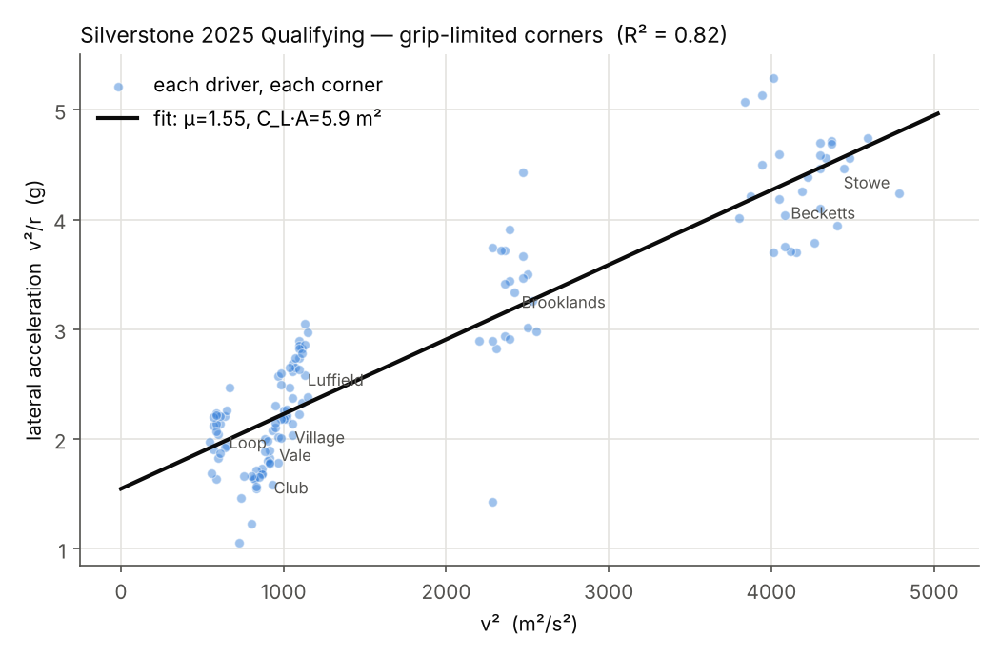
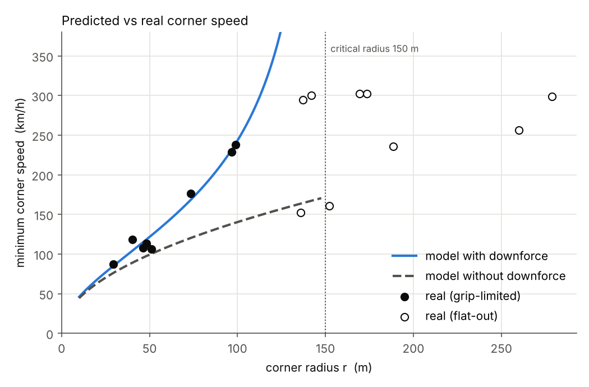
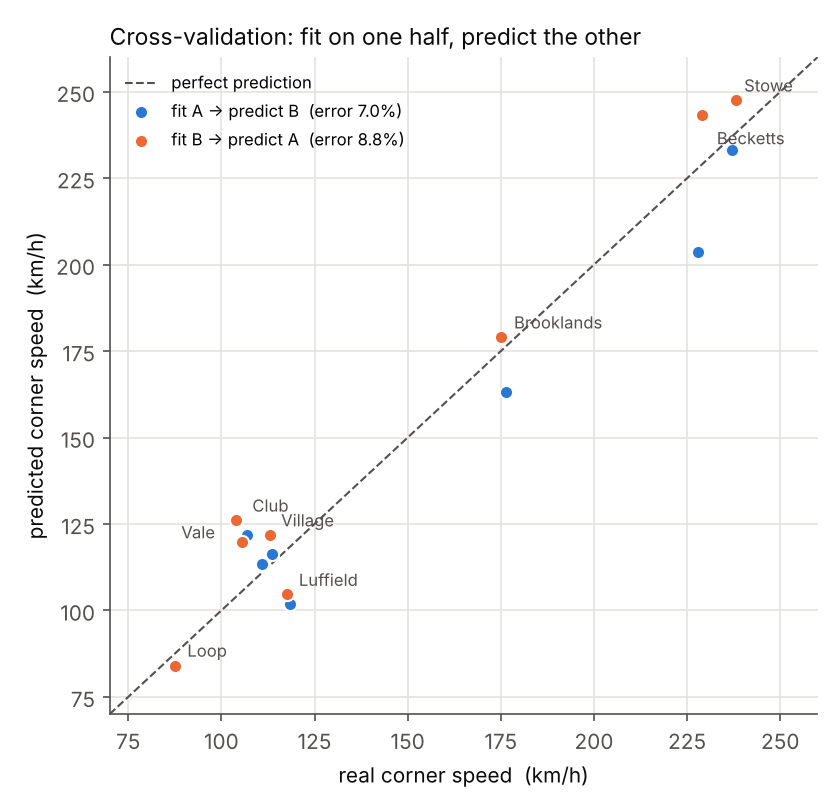

# F1 코너 최고속도 모델

원운동, 타이어 마찰, 다운포스를 하나의 식으로 묶어 F1 차량의 코너 최고속도를 예측하고, 2025 영국 그랑프리(실버스톤) 예선 텔레메트리로 검증한 프로젝트입니다.

2026학년도 2학기 물리 수행평가(공학적 도구를 활용한 물리현상 모델링과 정량적 검증)로 진행했습니다.



## 모델

코너를 도는 데 필요한 구심력을 타이어 마찰력이 공급하고, 다운포스가 수직항력을 키워 마찰 한계를 올린다고 봅니다.

```
m·v²/r = μ·(m·g + ½·ρ·C_L·A·v²)

v = √( μ·g·r / (1 − μ·ρ·C_L·A·r / 2m) )
```

분모가 0이 되는 반경(임계 반경)보다 큰 코너에서는 속도를 올릴수록 그립이 필요량보다 빨리 늘어나므로, 이론상 그립 한계가 사라지고 풀스로틀로 통과하게 됩니다.

```
r_임계 = 2m / (μ·ρ·C_L·A)
```

μ와 C_L·A는 공개된 값이 없어서 데이터에서 역산합니다. 양변을 m으로 나누면 직선이 됩니다.

```
v²/r = μ·g + (μ·ρ·C_L·A / 2m)·v²      →   y = a + b·x
절편 a → μ,   기울기 b → C_L·A,   1/b → 임계 반경
```

## 데이터 처리

| 단계 | 내용 | 이유 |
|---|---|---|
| 세션 선택 | 2025 영국 GP 예선, 드라이버 20명의 최고 랩 | 혼자 달린 랩이라 앞차 난기류가 없고, 새 타이어에 연료가 거의 없음 |
| 코너 정점 | 속도가 8 km/h 이상 떨어졌다 다시 오르는 최저점 | 일정한 상태로 도는 순간만 사용 |
| 제외 | 정점에서 스로틀 98% 이상이거나 브레이크를 밟은 점 | 그립 한계가 아닌 점 제거 |
| 코너 반경 | 정점 앞뒤 35 m 좌표에 최소제곱법으로 원 맞춤 | 점 3개 원보다 측정 오차에 덜 민감 |
| 공기 밀도 | 세션 기온, 기압, 습도로 계산 | 고정값 1.2 대신 실측 조건 반영 |

## 결과

| 항목 | 값 |
|---|---|
| 마찰계수 μ | 1.55 |
| 다운포스 계수 C_L·A | 5.88 m² |
| 임계 반경 | 150 m |
| R² | 0.82 |
| 그립 한계 코너 8곳 평균 예측 오차 | 6.0% |
| 교차 검증 예측 오차 (팀별로 반씩 나눠 서로 예측) | 7.0%, 8.8% |



반경이 150 m를 넘는 Abbey, Farm, Woodcote, Maggotts는 실제로 모두 풀스로틀 코너였습니다. 이 코너들은 직선 맞춤에 쓰지 않은 데이터라 모델을 독립적으로 확인한 결과입니다.



## 검증 실험에서 알게 된 것

- 반경 측정 구간을 70 m로 늘리면 R²는 0.91로 오르지만 예측 오차는 12%로 두 배가 됩니다. 급한 코너에서 직선 구간까지 원 맞춤에 섞여 반경이 부풀려지기 때문입니다. R²만 보고 설정을 고르면 안 됩니다.
- C_L·A를 0으로 두면 고속 코너 속도를 전혀 설명하지 못합니다 (Stowe: 모델 139 km/h, 실제 238 km/h).
- μ를 0.1로 낮추면 C_L·A를 유지해도 속도가 거의 오르지 않습니다. 다운포스는 마찰을 거쳐야 코너 속도로 바뀝니다.
- 임계 반경에 가까운 코너일수록 반경의 작은 오차가 예측을 크게 흔듭니다 (Becketts).

## 한계

- 타이어 하중 민감도(세게 눌릴수록 μ가 떨어지는 현상)와 속도에 따른 C_L·A 변화는 데이터가 없어 반영하지 못했습니다. 둘 다 고속 코너에서 모델이 실제보다 빠르게 예측하는 방향입니다.
- Luffield(반경이 계속 변하는 긴 코너)와 Club(가속 트랙션이 한계인 출구 코너)은 오차가 큽니다.

## 실행 방법

```
pip install -r requirements.txt
python silverstone_corner_model.py
```

- 처음 실행하면 FastF1으로 F1 공식 타이밍 서버에서 데이터를 받아 `data/` 폴더에 CSV로 저장하고, 그다음부터는 저장된 CSV를 씁니다.
- F1 서버가 요청을 막는 경우가 있습니다. 이때는 데이터를 받을 수 없어 실행이 멈춥니다.
- 결과 그래프와 표는 `out/` 폴더에 저장됩니다.
- 파일 맨 위 `내가 정한 값` 블록에서 반경 측정 구간, 스로틀 기준, 질량을 바꿔 실험할 수 있습니다.

## 데이터 출처

텔레메트리는 [FastF1](https://github.com/theOehrly/Fast-F1)을 통해 받은 Formula 1 공식 타이밍 데이터입니다. 데이터의 권리는 Formula 1에 있어 이 저장소에는 포함하지 않았습니다. 이 프로젝트는 Formula 1과 관련이 없는 비상업적 학습 프로젝트입니다.
